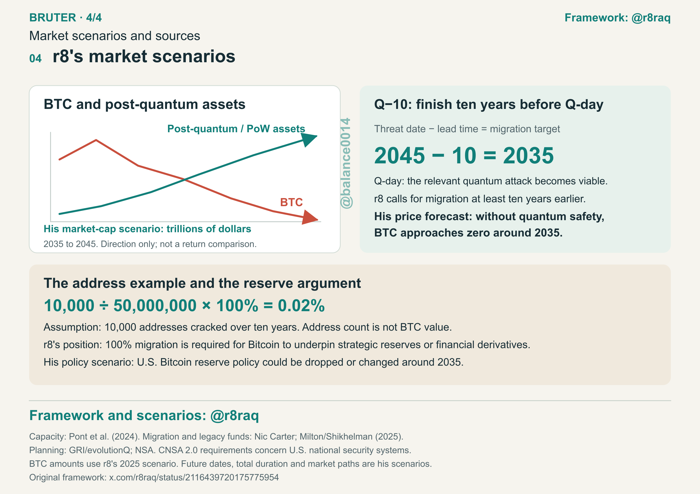

# Post-Quantum Blockchains

A continuously maintained, source-checked map of post-quantum cryptography in blockchains: which networks use it, for what, and with which limits. Projects can submit themselves, and every entry shows the date it was last checked.

**[Open the website](https://balance0014.github.io/post-quantum-blockchains/)**: every chain in the CoinGecko top 100 with its own network, plus the post-quantum chains, rated from stage 0 to 5 and checked every week ([how it's rated](docs/stages.md)).

**[Submit a project](https://github.com/Balance0014/post-quantum-blockchains/issues/new?template=new-project.yml)** · [Browse the projects](docs/projects.md) · [Resources](docs/resources.md) · [Compare signature sizes](docs/signature-sizes.md) · [Download CSV](data/projects.csv) · [Report a correction](https://github.com/Balance0014/post-quantum-blockchains/issues/new?template=correction.yml) · [中文](README.zh-CN.md)

<!-- summary: generated by scripts/export.py from data/projects.json -->
Across the 25 listed projects (data as of November 27, 2026):

- **20 of the 25** use a post-quantum scheme on their default transaction path.
- **4** offer it only as an opt-in account, lock or demo: Nexus, Starknet, Algorand and Nervos CKB.
- **1** isn't on mainnet yet: QANplatform (testnet).
<!-- /summary -->

## What's in the map

| Part | What it covers |
| --- | --- |
| [Stage tracker website](https://balance0014.github.io/post-quantum-blockchains/) | Can holders use a post-quantum signature today? Stage 0 to 5 for the largest blockchains and the post-quantum chains, with each chain's newest block, releases and code activity read every week. Data in [chains.json](data/chains.json), rules in [stages.md](docs/stages.md). |
| [Chains and projects](docs/projects.md) | Networks that use post-quantum cryptography to sign transactions, lock funds or prove state: what is deployed, where, since when and with which limits. Also as [CSV](data/projects.csv) and [JSON](data/projects.json). |
| [Resources](docs/resources.md) | Standards, Bitcoin proposals, wallets, libraries and papers. |
| [Algorithms](#algorithm-map) | Which scheme families each project uses, plus reference [public-key and signature sizes](docs/signature-sizes.md). |
| [Bitcoin migration](#bitcoin-migration-and-governance) | r8's BRUTER framework and the coins left behind: English and Chinese diagrams, sources and a reproducible capacity calculation. |

**What gets listed:** every claim needs a public primary source, such as release notes, a specification, governance records or code pinned to a commit, and a clear status: on by default, opt-in, testnet, demo or planned. The full bar is in the [methodology](docs/methodology.md) and under [Submit a project](#submit-a-project).

**How it stays current:** a maintainer replies to every submission and correction within 2 days, and a review decision usually comes within 3 days. Accepted changes go into the data, the tables, both charts and the [changelog](CHANGELOG.md) when they're merged, and each entry keeps its own review date. The first 17 entries were reviewed October 23, 2026. The Bitcoin note uses sources reviewed October 31, with a GitHub edition dated November 3.

It began as two maps I posted on [X](https://x.com/balance0014) on October 23, 2026, and the first entries were [re-checked](docs/release-review.md) before release. It isn't a security ranking or a price signal.

Maintained by Balance Zhao ([@balance0014](https://x.com/balance0014)).

## Charts

Both charts are drawn by [`scripts/charts.py`](scripts/charts.py) from the project and size data, so they change whenever an entry does. Each is stamped with the latest review date in the data.

### Deployment timeline

Each card's year is the milestone written on it: a chain launch, a later cryptographic upgrade, or a public testnet. It doesn't mean every feature on the card existed that year. The bar on each card shows whether the post-quantum scheme is on by default, opt-in or a demo, or not on mainnet yet.


### Algorithm map

A project can sit under more than one scheme family. STARK proofs are shown apart because they don't sign transactions, and key-encapsulation mechanisms are left out. The lower panel compares reference public-key and signature sizes on a log scale.


## Bitcoin migration and governance

If new spending rules become available, funds left under the old rules still need attention. The [Bitcoin migration note](research/bitcoin-migration/r8-bruter/README.md) explains r8's framework, the difference between activation and holder migration, and the rights of people whose funds haven't moved. Its four diagrams are available in [English](research/bitcoin-migration/r8-bruter/README.md) and [Chinese](research/bitcoin-migration/r8-bruter/README.zh-CN.md), as PNG and editable SVG.

r8's timing assumptions are attributed scenarios. The separate historical capacity calculation measures idealized chain processing. Dates and prices in the original images are r8's scenarios, not findings established by this repository.

The images below reproduce the original English edition, including r8's market scenarios. The later Chinese edition has a different scope.




## Easy to misread

- **Mochimo** is recorded as PoS, after its October 2026 switch. It ran PoW before that.
- **QANplatform:** the QANX token trades, but QAN's post-quantum chain is still a testnet.
- **Starknet:** the 2021 milestone is L2 Mainnet Alpha. The vote on becoming an independent L1 backed research; it didn't approve leaving Ethereum.
- **Raqcoin:** 2018 is when its predecessor ABCMint launched, not when UOV was added. ABCMint's original Rainbow parameters are publicly broken. Raqcoin's guide still lists a Rainbow configuration (274) as the default, and this repo hasn't analyzed that configuration.
- **Quantus and qtcchain** both use the ticker QTC. They're different chains, so go by the project ID and the sources.

## What the data covers

An opt-in post-quantum lock only protects coins you move into it. Old accounts, consensus keys and bridges stay as they were.

The size table gives raw public-key and signature bytes for specific parameter sets. Those aren't transaction sizes, fees or a security ranking, and the UOV rows aren't measurements of Raqcoin transactions.

When a claim cites the project's own documentation, read it as "the project says so", not as an audit. <!-- pinned: generated by scripts/export.py from data/sources.json -->33 of the 106 sources are pinned to a specific commit<!-- /pinned -->; project web pages can change or disappear.

The list started with the projects on the original maps. It's open to any project that meets the evidence bar in the [methodology](docs/methodology.md); see [Submit a project](#submit-a-project).

## Submit a project

Building with post-quantum cryptography, or know a project that is? [Open a submission](https://github.com/Balance0014/post-quantum-blockchains/issues/new?template=new-project.yml). You don't need to fork the repository or send a pull request.

**What gets listed**

- A blockchain, layer 2 or other network that uses a post-quantum scheme to sign transactions, exchange keys or prove state. Wallets, libraries, standards and papers are welcome too; they go into the [resource list](docs/resources.md).
- A public primary source for each claim: release notes, a specification, governance records or code pinned to a commit. An announcement or press coverage isn't enough on its own.
- A clear status: on by default on mainnet, opt-in on mainnet, testnet, demo or planned. Planned work is listed as planned.

**How review works**

- You get an automatic reply that checks your links and looks for an existing entry. A maintainer replies within 2 days; a review decision usually comes within 3 days.
- Every claim is checked against its sources before it's added, and the entry records the date it was checked.
- Accepted entries appear in the [project comparison](docs/projects.md), the CSV and both charts, which are redrawn from the data, and the change is noted in the [changelog](CHANGELOG.md).
- Listing is free and isn't for sale. Entries describe what is deployed; they aren't scores or endorsements.
- If you work on the project, say so in the form. Team submissions are welcome and get the same check.

**Listed?** Show your chain's stage with its live badge, for example [](https://balance0014.github.io/post-quantum-blockchains/chains/algorand/). It updates with the data and links to your chain's page. Copy the code from the [data page](https://balance0014.github.io/post-quantum-blockchains/data/#embed) or [CONTRIBUTING](CONTRIBUTING.md#stage-badge).

## Reuse or contribute

Download the data, cite the review date of the entries you use and say what you changed. From version 0.5.0, data, charts and prose are **CC BY-NC 4.0**, and scripts are **MIT**. Linked third-party material keeps its own terms. See [LICENSE](LICENSE).

**Commercial use is free on three conditions** (an additional permission beyond CC BY-NC):

1. Every screen that uses the data shows this credit with both links: "Data: [Post-Quantum Blockchains](https://balance0014.github.io/post-quantum-blockchains/), by [Balance Zhao](https://x.com/balance0014)". The [official badge and card](https://balance0014.github.io/post-quantum-blockchains/data/#embed) carry it for you.
2. Show the date the data was checked, and update your copy at least once a week.
3. Register the use in a ["Used by" issue](https://github.com/Balance0014/post-quantum-blockchains/issues/new?template=used-by.yml).

Can't meet them? Ask in a GitHub issue or by direct message on [X](https://x.com/balance0014). Versions up to 0.4.0 stay under CC BY 4.0. The website's [data page](https://balance0014.github.io/post-quantum-blockchains/data/) documents the JSON files as an API.

### Used by

Products that registered a use are listed here. None yet: [register yours](https://github.com/Balance0014/post-quantum-blockchains/issues/new?template=used-by.yml).

To correct something, send the specific claim, a primary source and the network or version it applies to. Project teams are welcome; changes go through the same evidence check. [Report a correction](https://github.com/Balance0014/post-quantum-blockchains/issues/new?template=correction.yml) or [submit a project](https://github.com/Balance0014/post-quantum-blockchains/issues/new?template=new-project.yml).

The scripts need Python 3.9+ and nothing else (CI runs 3.9 and 3.12):

```sh
python3 scripts/validate.py   # checks the files agree: IDs, link format, checksums, generated files
python3 scripts/export.py     # rebuilds the tables, CSVs, charts and the summary at the top of this page
```

`validate.py` doesn't fetch the links or re-check claims; it catches mismatches between files. CI fails if the charts, tables or summary no longer match the data. Bitcoin diagrams preserve the [original published editions](research/bitcoin-migration/r8-bruter/sources.md#original-image-editions).

[Follow the research on X](https://x.com/balance0014) · [Changelog](CHANGELOG.md) · [How to cite](CITATION.cff)
