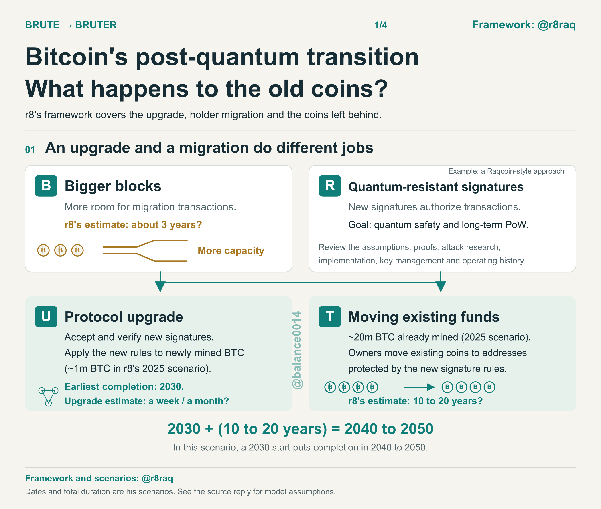
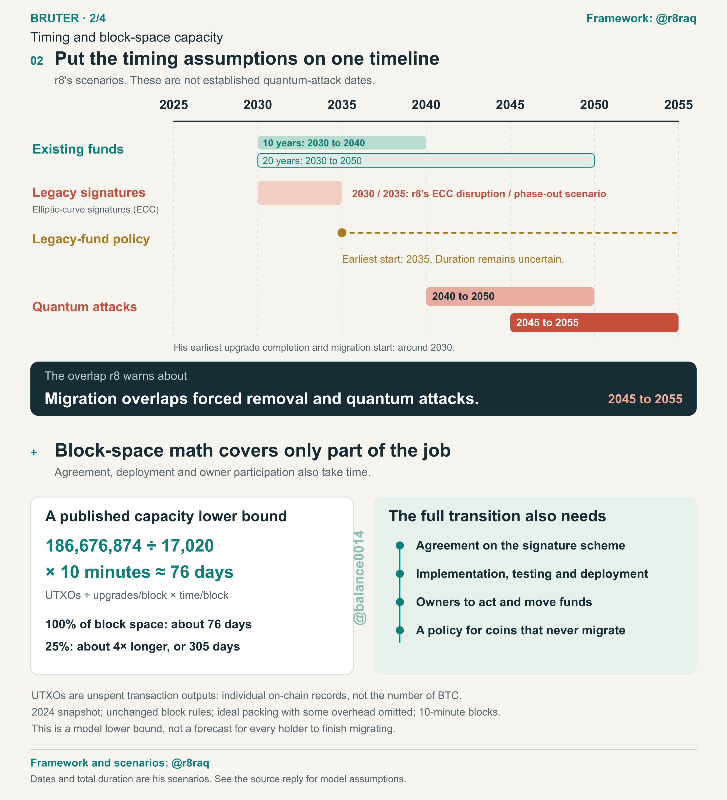
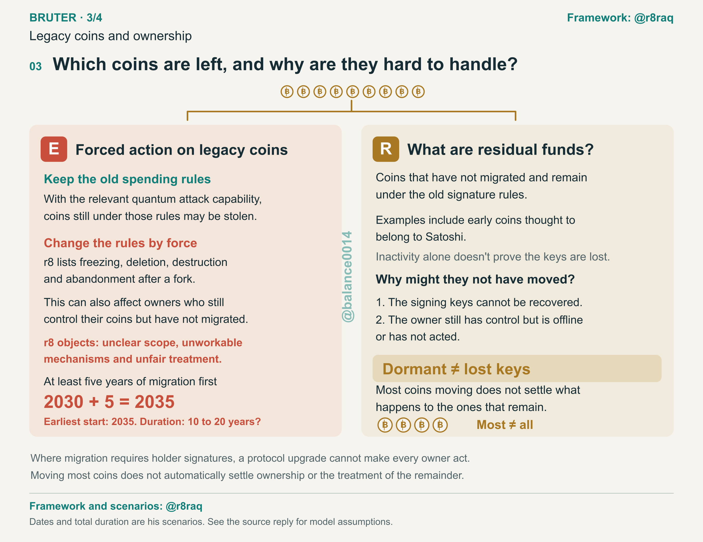

# Post-Quantum Blockchains

Where post-quantum cryptography is used in crypto, how signing schemes compare, and what Bitcoin migration would ask of holders.

This is an open, source-checked map. Project teams and readers can [submit a project](https://github.com/Balance0014/post-quantum-blockchains/issues/new?template=new-project.yml) or a correction, and every entry shows the date it was last checked.

| Research | Start here |
| --- | --- |
| Project deployments | [17-project comparison](docs/projects.md): what is deployed, where, and with which limits. |
| Algorithms | [Algorithm map](#algorithm-map) and [signature sizes](docs/signature-sizes.md): roles, parameters and encodings. |
| Bitcoin migration | [r8's BRUTER framework and the coins left behind](#bitcoin-migration-and-governance): original English and Chinese diagrams, sources and a reproducible capacity calculation. |

The 17 original project entries and both maps date from October 23, 2026. New and corrected entries go through the same evidence check and carry their own review date; every change is logged in the [changelog](CHANGELOG.md). The Bitcoin note uses sources reviewed October 31, with a GitHub edition dated November 3.

**[Submit a project](https://github.com/Balance0014/post-quantum-blockchains/issues/new?template=new-project.yml)** · [Browse the projects](docs/projects.md) · [Resources](docs/resources.md) · [Compare signature sizes](docs/signature-sizes.md) · [Download CSV](data/projects.csv) · [Report a correction](https://github.com/Balance0014/post-quantum-blockchains/issues/new?template=correction.yml) · [中文](README.zh-CN.md)

As of October 23, 2026:

- **12 of the 17** use a post-quantum scheme on their default transaction path.
- **4** offer it only as an opt-in account, lock or demo: Nexus, Starknet, Algorand and Nervos CKB.
- **1** is testnet-only: QANplatform.

It started as two maps I posted on [X](https://x.com/balance0014). This is the data behind them, so you can check my work and tell me what I got wrong. I published it on October 28 after [a few re-checks](docs/release-review.md), and it's now open for new projects. It isn't a security ranking or a price signal.

Maintained by Balance Zhao ([@balance0014](https://x.com/balance0014)).

## Research maps and explainers

### Deployment timeline

Each card's year is the milestone written on it: a chain launch, a later cryptographic upgrade, or a public testnet. It doesn't mean every feature on the card existed that year. [Full-resolution PNG](charts/deployment-timeline-2026-10-23.png).


### Algorithm map

A project can sit under more than one scheme, and opt-in features, fallbacks, testnets and demos are labeled. STARK proofs and key-encapsulation mechanisms are shown apart because they don't sign transactions. [Full-resolution PNG](charts/algorithm-map-2026-10-23.png).


### Bitcoin migration and governance

If new spending rules become available, funds left under the old rules still need attention. The [Bitcoin migration note](research/bitcoin-migration/r8-bruter/README.md) explains r8's framework, the difference between activation and holder migration, and the rights of people whose funds haven't moved. Its four diagrams are available in [English](research/bitcoin-migration/r8-bruter/README.md) and [Chinese](research/bitcoin-migration/r8-bruter/README.zh-CN.md), as PNG and editable SVG.

r8's timing assumptions are attributed scenarios. The separate historical capacity calculation measures idealized chain processing. Dates and prices in the original images are r8's scenarios, not findings established by this repository.

The images below reproduce the original English edition, including r8's market scenarios. The later Chinese edition has a different scope.








## Easy to misread

- **Mochimo** is recorded as PoS, after its October 2026 switch. It ran PoW before that.
- **QANplatform:** the QANX token trades, but QAN's post-quantum chain is still a testnet.
- **Starknet:** the 2021 milestone is L2 Mainnet Alpha. The vote on becoming an independent L1 backed research; it didn't approve leaving Ethereum.
- **Raqcoin:** 2018 is when its predecessor ABCMint launched, not when UOV was added. ABCMint's original Rainbow parameters are publicly broken. Raqcoin's guide still lists a Rainbow configuration (274) as the default, and this repo hasn't analyzed that configuration.
- **Quantus and qtcchain** both use the ticker QTC. They're different chains, so go by the project ID and the sources.

## What the data covers

An opt-in post-quantum lock only protects coins you move into it. Old accounts, consensus keys and bridges stay as they were.

The size table gives raw public-key and signature bytes for specific parameter sets. Those aren't transaction sizes, fees or a security ranking, and the UOV rows aren't measurements of Raqcoin transactions.

When a claim cites the project's own documentation, read it as "the project says so", not as an audit. 19 of the 81 sources are pinned to a specific commit; project web pages can change or disappear.

The list started with the projects on the original maps. It's open to any project that meets the evidence bar in the [methodology](docs/methodology.md); see [Submit a project](#submit-a-project).

## Submit a project

Building with post-quantum cryptography, or know a project that is? [Open a submission](https://github.com/Balance0014/post-quantum-blockchains/issues/new?template=new-project.yml). You don't need to fork the repository or send a pull request.

**What gets listed**

- A blockchain, layer 2 or other network that uses a post-quantum scheme to sign transactions, exchange keys or prove state. Wallets, libraries and standards are welcome too; they go into the [resource list](docs/resources.md).
- A public primary source for each claim: release notes, a specification, governance records or code pinned to a commit. An announcement or press coverage isn't enough on its own.
- A clear status: on by default on mainnet, opt-in on mainnet, testnet, demo or planned. Planned work is listed as planned.

**How review works**

- You get an automatic reply that checks your links and looks for an existing entry. A maintainer replies within 7 days.
- Every claim is checked against its sources before it's added, and the entry records the date it was checked.
- Accepted entries appear in the [project comparison](docs/projects.md) and the CSV, and the change is noted in the [changelog](CHANGELOG.md). The two maps above stay dated October 23 until they're redrawn.
- Listing is free and isn't for sale. Entries describe what is deployed; they aren't scores or endorsements.
- If you work on the project, say so in the form. Team submissions are welcome and get the same check.

## Reuse or contribute

Download the data, cite the review date of the entries you use and link back here. If you change it, say what changed. Data, charts and prose are **CC BY 4.0**; scripts are **MIT**. Linked third-party material keeps its own terms. See [LICENSE](LICENSE).

To correct something, send the specific claim, a primary source and the network or version it applies to. Project teams are welcome; changes go through the same evidence check. [Report a correction](https://github.com/Balance0014/post-quantum-blockchains/issues/new?template=correction.yml) or [submit a project](https://github.com/Balance0014/post-quantum-blockchains/issues/new?template=new-project.yml).

The scripts need Python 3.10+ and nothing else (CI runs 3.12):

```sh
python3 scripts/validate.py   # checks the files agree: IDs, link format, checksums, exports
python3 scripts/export.py     # rebuilds the readable tables and CSVs
```

`validate.py` doesn't fetch the links or re-check claims; it catches mismatches between files. The original map PNGs are release artifacts, and the export script doesn't redraw them. Bitcoin diagrams preserve the [original published editions](research/bitcoin-migration/r8-bruter/sources.md#original-image-editions).

[Follow the research on X](https://x.com/balance0014) · [Changelog](CHANGELOG.md) · [How to cite](CITATION.cff)
