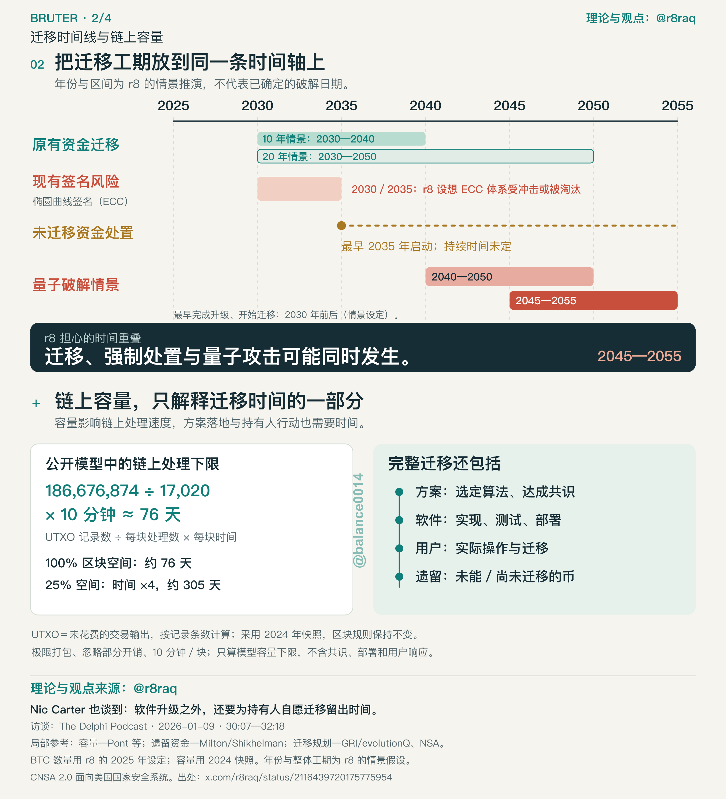
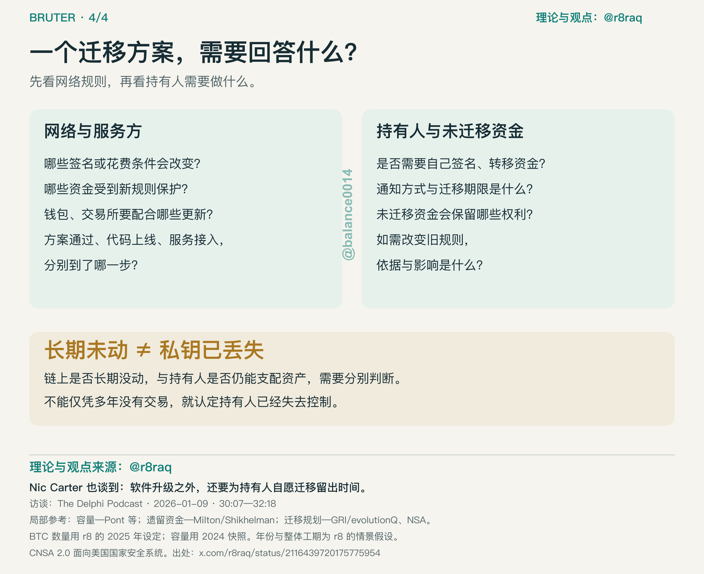

# 抗量子区块链研究（Post-Quantum Blockchains）

研究抗量子方案在加密网络中的部署、算法差异，以及比特币迁移时持有人需要面对的问题。

这是一张开放收录、逐条核对出处的全景图。项目方和读者都可以[提交项目](https://github.com/Balance0014/post-quantum-blockchains/issues/new?template=new-project.yml)或纠错，每一条都标着最后核对的日期。

| 研究方向 | 阅读入口 |
| --- | --- |
| 项目部署 | [17 个项目对比](docs/projects.md)：已经部署什么、用在哪里、有什么限制。 |
| 算法对比 | [算法地图](#算法地图)与[签名尺寸](docs/signature-sizes.md)：用途、参数和编码。 |
| 比特币迁移 | [r8 的 BRUTER 框架与未迁移资金](#比特币迁移与治理)：中英文图解、来源和可复算的容量算例。 |

最初的 17 个项目和两张图截至 2026 年 10 月 23 日。新增和更正的条目经过同样的证据核对，各自标注核对日期，每次改动都记在[更新记录](CHANGELOG.md)里。比特币专题采用 10 月 31 日核对的来源版本，GitHub 版整理于 11 月 3 日。

**[提交项目](https://github.com/Balance0014/post-quantum-blockchains/issues/new?template=new-project.yml)** · [纠错](https://github.com/Balance0014/post-quantum-blockchains/issues/new?template=correction.yml) · [English](README.md) · 整理维护：Balance Zhao（[@balance0014](https://x.com/balance0014)）

截至 2026 年 10 月 23 日：

- **17 个里有 12 个**，日常交易默认就走抗量子方案。
- **4 个**只把它做成可选账户、可选锁或演示：Nexus、Starknet、Algorand、Nervos CKB。
- **1 个**还只有测试网：QANplatform。

这些数据来自我在 [X](https://x.com/balance0014) 上发的两张图：一张是各项目的抗量子部署时间线，一张是算法分布和签名尺寸对比。10 月 28 日开源前又抽查了几项（[抽查记录](docs/release-review.md)），现在开放收录新项目。两张图保持 10 月 23 日的版本，重画前不会变；这不是安全排名，也不是价格信号。

## 研究图谱与图解

### 部署时间线

### 算法地图

### 比特币迁移与治理

新的花费规则可用之后，仍受旧规则控制的资金怎么办？[比特币专题](research/bitcoin-migration/r8-bruter/README.zh-CN.md)解释 r8 的框架、网络激活与持有人迁移的区别，以及未迁移资金涉及的权利问题。四张图提供原版[中文](research/bitcoin-migration/r8-bruter/README.zh-CN.md)和[英文](research/bitcoin-migration/r8-bruter/README.md)版本，附高清 PNG、可编辑 SVG 与来源。

r8 的时间设定保留情景归属，历史容量算例单独说明。原图中的日期与价格预测归属 r8，并非本资料库已经证实的结论。

下列图片原样使用此前发布的中文四图。英文原版保留作者的市场情景，两版范围不同。

## 容易看错的几处

- **Mochimo**：记的是 2026 年 10 月转成 PoS 之后的状态，之前是 PoW。
- **QANplatform**:QANX 代币在交易，但它的抗量子链还只是测试网。
- **Starknet**:2021 年那个节点是 L2 主网 Alpha。转独立 L1 的投票只同意继续研究，没有批准离开以太坊。
- **Raqcoin**:2018 年是前身 ABCMint 上线，不是开始用 UOV 的年份。ABCMint 原来的 Rainbow 参数已被公开攻破；Raqcoin 的指南里默认的仍是一套 Rainbow 配置（274），本资料库没有分析过这套配置。
- **Quantus 和 qtcchain**：代币符号都是 QTC，但是两条不同的链，请按项目 ID 和出处区分。

## 这份数据能说明什么

- 可选的抗量子锁，只保护你转进去的那部分币。老账户、共识密钥、跨链桥都不会因此改变。
- 尺寸表是特定参数下的公钥和签名字节数，不是整笔交易大小、手续费，也不是安全排名；表里的 UOV 数值不是 Raqcoin 交易的实测。
- 出处是项目自己文档的，请理解为「项目方这么说」，不是审计结论。81 条出处里有 19 条固定到了具体代码版本；项目网页可能改动或下线。
- 一开始收录的是原来两张图上的项目，现在对所有达到证据门槛的项目开放，门槛见[方法说明](docs/methodology.md)（英文），提交方式见下文[提交项目](#提交项目)。

## 提交项目

在做抗量子相关的项目，或者知道有谁在做？[填表提交](https://github.com/Balance0014/post-quantum-blockchains/issues/new?template=new-project.yml)就行，不用 fork 仓库，也不用提 PR。

**收录什么**

- 用抗量子方案签交易、交换密钥或证明状态的区块链、二层网络或其他网络。钱包、库和标准也欢迎，会单独放进资源列表。
- 每条说法都要有公开的一手出处：发布说明、规格文档、治理记录，或固定到具体提交的代码。只有公告或媒体报道不够。
- 写清状态：主网默认开启、主网可选、测试网、演示，还是计划中。计划中的就按计划中收录。

**怎么审核**

- 每条说法都对照出处核过才收录，条目上记下核对日期。
- 收录后出现在[项目对比](docs/projects.md)和 CSV 里，改动记进[更新记录](CHANGELOG.md)。上面两张图保持 10 月 23 日的版本，重画前不会变。
- 收录免费，不卖位置。条目只描述已经部署的东西，不是打分，也不是背书。
- 如果你是项目方成员，请在表里说明。项目方提交一样欢迎，核对标准相同。

## 怎么用、怎么纠错

可以下载[项目表 CSV](data/projects.csv) 或 [JSON](data/projects.json) 自己分析。引用时请注明所用条目的核对日期并链回本仓库，改过的请说明改了什么。数据、图片和文字用 CC BY 4.0，脚本用 MIT，详见 [LICENSE](LICENSE)。

发现错误请[纠错](https://github.com/Balance0014/post-quantum-blockchains/issues/new?template=correction.yml)，写清是哪一条、原始出处、对应的网络和版本，我核实后更新。想补项目请[提交项目](https://github.com/Balance0014/post-quantum-blockchains/issues/new?template=new-project.yml)。
