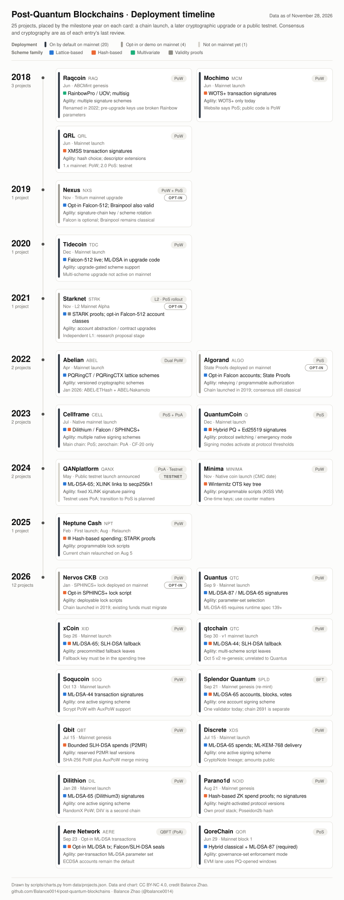
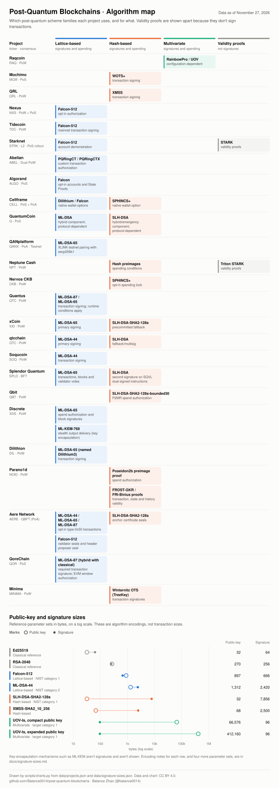
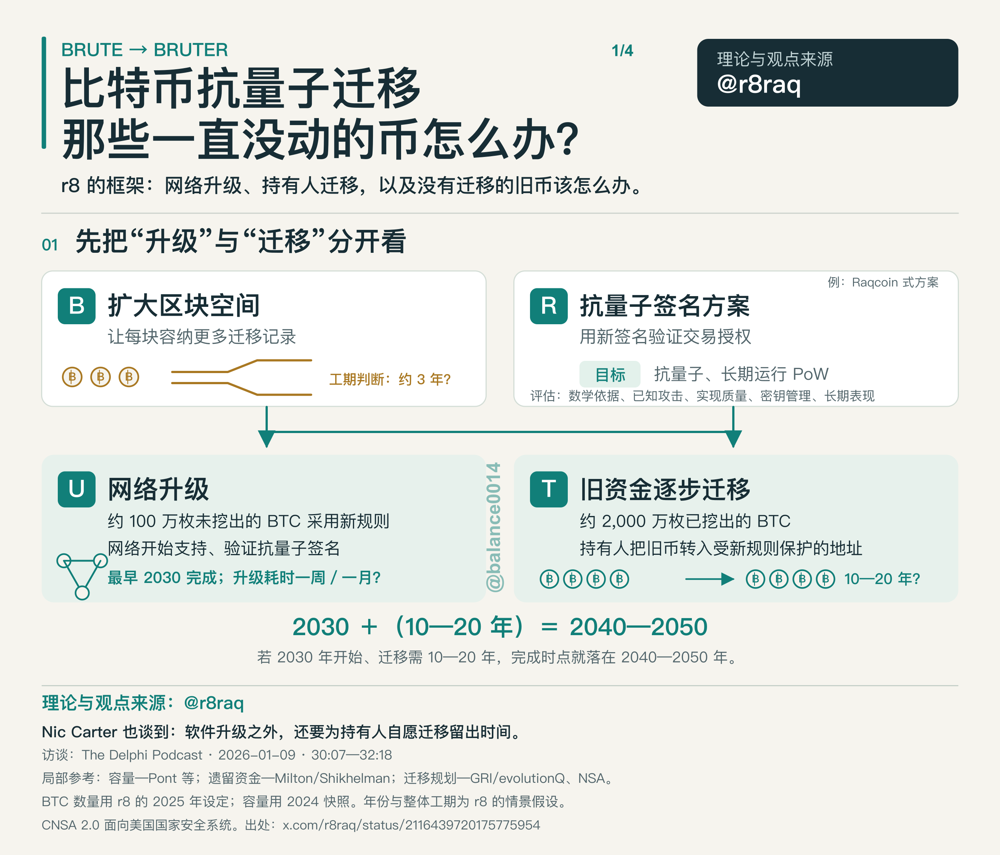
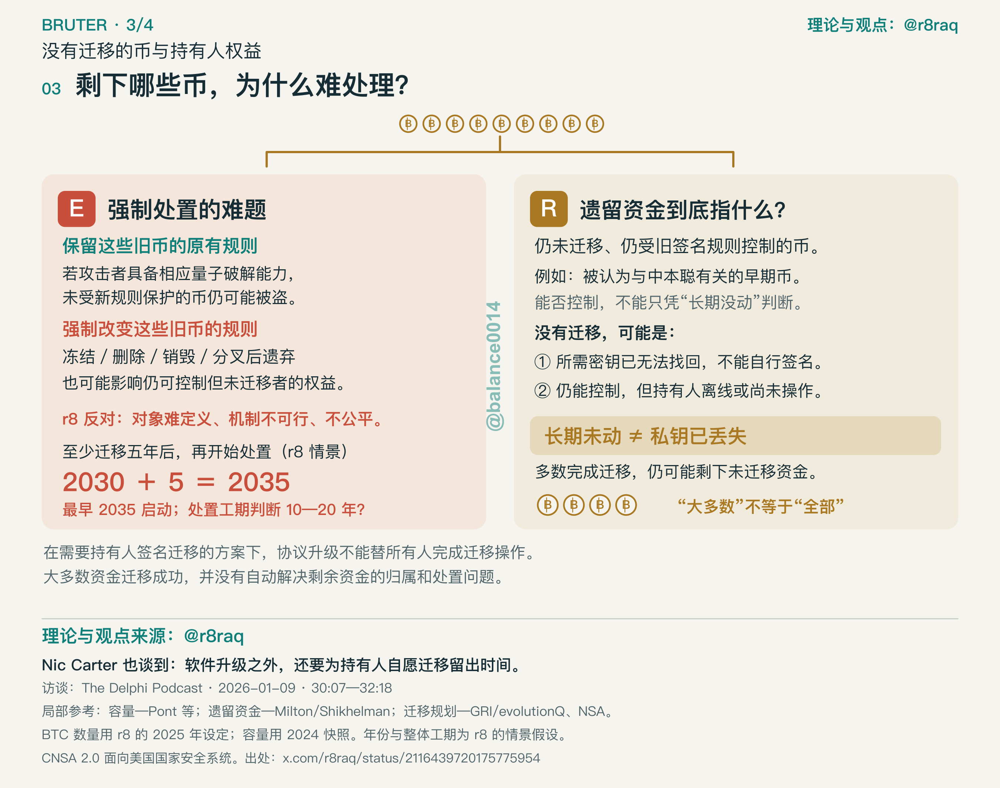

# 抗量子区块链（Post-Quantum Blockchains）

一张持续维护、逐条核对出处的全景图，记录抗量子密码在区块链里的应用：哪些网络在用、用在哪里、有什么限制。项目方可以自己提交，每一条都标着最后核对的日期。

**[打开网站](https://balance0014.github.io/post-quantum-blockchains/zh/)**：CoinGecko 市值前 100 中有自己网络的链和原生抗量子链，每条评 0 到 5 档，每周巡查一次（[评档规则](docs/stages.md)，英文）。

**[提交项目](https://github.com/Balance0014/post-quantum-blockchains/issues/new?template=new-project.yml)** · [项目对比](docs/projects.md) · [资源列表](docs/resources.md) · [签名尺寸](docs/signature-sizes.md) · [下载 CSV](data/projects.csv) · [纠错](https://github.com/Balance0014/post-quantum-blockchains/issues/new?template=correction.yml) · [English](README.md)

<!-- summary: generated by scripts/export.py from data/chains.json, the same counts as the website's home page -->
数据截至 2026 年 11 月 27 日：

- 市值最大的 43 条区块链（CoinGecko 市值前 100 中有自己网络的）里，今天有 **3** 条能让持币人在主网上使用抗量子签名：NEAR Protocol、Bittensor、Algorand。
- 收录的全部 **68** 条链里，主网已能用抗量子签名的有 **26** 条（默认 19 条、可选 7 条）。
- 68 条里有 **34** 条，近 90 天有官方号或核心人物在 X 上谈抗量子（63 条原帖，逐条核对）：[看 X 上的讨论](https://balance0014.github.io/post-quantum-blockchains/zh/x/)。
<!-- /summary -->

## 全景图里有什么

| 部分 | 内容 |
| --- | --- |
| [抗量子进度网站](https://balance0014.github.io/post-quantum-blockchains/zh/) | 持币人今天能不能用抗量子签名？为市值最大的区块链和原生抗量子链评 0 到 5 档，每周读取每条链的最新区块、发布版本和代码活跃度。数据在 [chains.json](data/chains.json)，规则在 [stages.md](docs/stages.md)。 |
| [链与项目](docs/projects.md) | 用抗量子密码签交易、锁资金或证明状态的网络：已经部署什么、用在哪里、从什么时候开始、有什么限制。也有 [CSV](data/projects.csv) 和 [JSON](data/projects.json) 版本。 |
| [资源列表](docs/resources.md) | 标准、比特币提案、钱包、库和论文（英文）。 |
| [算法](#算法地图) | 每个项目用了哪类方案，以及参考用的[公钥和签名尺寸](docs/signature-sizes.md)。 |
| [比特币迁移](#比特币迁移与治理) | r8 的 BRUTER 框架与未迁移资金：中英文图解、来源和可复算的容量算例。 |

<!-- projects-summary: generated by scripts/export.py from data/projects.json -->
**链与项目清单**收录了 25 个已经用上抗量子密码的项目（数据截至 2026 年 11 月 28 日）：

- **25 个里有 20 个**，日常交易默认就走抗量子方案。
- **4 个**只把它做成可选账户、可选锁或演示：Nexus、Starknet、Algorand、Nervos CKB。
- **1 个**还没上主网：QANplatform（测试网）。
<!-- /projects-summary -->

**收录门槛**：每条说法都要有公开的一手出处，比如发布说明、规格文档、治理记录，或固定到具体提交的代码；还要写清状态：主网默认开启、可选、测试网、演示还是计划中。完整标准见[方法说明](docs/methodology.md)（英文）和下文[提交项目](#提交项目)。

**更新节奏**：每条投稿和纠错 2 天内都会有人工回复，审核结果一般 3 天内给出。收录或更正合并后，数据、表格、两张图和[更新记录](CHANGELOG.md)一起更新，每个条目保留自己的核对日期。最初的 17 个项目核对于 2026 年 10 月 23 日；比特币专题采用 10 月 31 日核对的来源版本，GitHub 版整理于 11 月 3 日。

这张图最早是我 2026 年 10 月 23 日在 [X](https://x.com/balance0014) 上发的两张图，开源前又[抽查](docs/release-review.md)了一遍。这不是安全排名，也不是价格信号。

整理维护：Balance Zhao（[@balance0014](https://x.com/balance0014)）

## 图表

两张图都由 [`scripts/charts.py`](scripts/charts.py) 直接从项目数据和尺寸数据画出，条目一改，图就跟着更新；图上标着数据里最新的核对日期。图中文字为英文。

### 部署时间线

每张卡片上的年份是卡片写明的那个节点：主网上线、后来的密码学升级，或者公开测试网，不代表卡片上的功能当年都已经有了。卡片左侧的竖条表示抗量子方案是默认开启、可选或演示，还是还没上主网。

### 算法地图

一个项目可以同时出现在几类方案下。STARK 证明不签交易，所以单独列出；密钥封装机制不在图里。下半部分用对数刻度比较参考参数下的公钥和签名尺寸。

## 比特币迁移与治理

新的花费规则可用之后，仍受旧规则控制的资金怎么办？[比特币专题](research/bitcoin-migration/r8-bruter/README.zh-CN.md)解释 r8 的框架、网络激活与持有人迁移的区别，以及未迁移资金涉及的权利问题。四张图提供原版[中文](research/bitcoin-migration/r8-bruter/README.zh-CN.md)和[英文](research/bitcoin-migration/r8-bruter/README.md)版本，附高清 PNG、可编辑 SVG 与来源。

r8 的时间设定保留情景归属，历史容量算例单独说明。原图中的日期与价格预测归属 r8，并非本资料库已经证实的结论。

下列图片原样使用此前发布的中文四图。英文原版保留作者的市场情景，两版范围不同。

## 容易看错的几处

- **Mochimo**：记的是 2026 年 10 月转成 PoS 之后的状态，之前是 PoW。
- **QANplatform**：QANX 代币在交易，但它的抗量子链还只是测试网。
- **Starknet**：2021 年那个节点是 L2 主网 Alpha。转独立 L1 的投票只同意继续研究，没有批准离开以太坊。
- **Raqcoin**：2018 年是前身 ABCMint 上线，不是开始用 UOV 的年份。升级（分叉高度 267120）后，新密钥默认用 Rainbow 配置 274，暂无公开攻破，本资料库没有分析过这套配置。升级前生成的旧密钥用的是 ABCMint 原来的 Rainbow（16,32,32,32）参数，这组参数 2022 年已被攻破。节点仍能验证旧密钥的签名，旧地址里的币才转得出来；所以还留在旧地址、没迁走的币有风险，建议迁到新密钥。
- **Quantus 和 qtcchain**：代币符号都是 QTC，但是两条不同的链，请按项目 ID 和出处区分。

## 这份数据能说明什么

- 可选的抗量子锁，只保护你转进去的那部分币。老账户、共识密钥、跨链桥都不会因此改变。
- 尺寸表是特定参数下的公钥和签名字节数，不是整笔交易大小、手续费，也不是安全排名；表里的 UOV 数值不是 Raqcoin 交易的实测。
- 出处是项目自己文档的，请理解为「项目方这么说」，不是审计结论。<!-- pinned: generated by scripts/export.py from data/sources.json -->106 条出处里有 33 条固定到了具体代码版本<!-- /pinned -->；项目网页可能改动或下线。
- 一开始收录的是原来两张图上的项目，现在对所有达到证据门槛的项目开放，门槛见[方法说明](docs/methodology.md)（英文），提交方式见下文[提交项目](#提交项目)。

## 提交项目

在做抗量子相关的项目，或者知道有谁在做？[填表提交](https://github.com/Balance0014/post-quantum-blockchains/issues/new?template=new-project.yml)就行，不用 fork 仓库，也不用提 PR。

**收录什么**

- 用抗量子方案签交易、交换密钥或证明状态的区块链、二层网络或其他网络。钱包、库、标准和论文也欢迎，放进[资源列表](docs/resources.md)（英文）。
- 每条说法都要有公开的一手出处：发布说明、规格文档、治理记录，或固定到具体提交的代码。只有公告或媒体报道不够。
- 写清状态：主网默认开启、主网可选、测试网、演示，还是计划中。计划中的就按计划中收录。

**怎么审核**

- 提交后会自动回复一条，检查链接能不能打开、是不是已经收录过；2 天内会有人工回复，审核结果一般 3 天内给出。
- 每条说法都对照出处核过才收录，条目上记下核对日期。
- 收录后出现在[项目对比](docs/projects.md)、CSV 和两张图里（图由数据重新生成），改动记进[更新记录](CHANGELOG.md)。
- 收录免费，不卖位置。条目只描述已经部署的东西，不是打分，也不是背书。
- 如果你是项目方成员，请在表里说明。项目方提交一样欢迎，核对标准相同。

**已收录的链**可以在自己的 README 或官网上放实时档位徽章，例如 。徽章随数据自动更新，并链回这条链的页面。复制即用的代码见[数据页](https://balance0014.github.io/post-quantum-blockchains/zh/data/#embed)或 [CONTRIBUTING](CONTRIBUTING.md#stage-badge)（英文）。

## 怎么用、怎么纠错

可以下载[项目表 CSV](data/projects.csv) 或 [JSON](data/projects.json) 自己分析。引用时请注明所用条目的核对日期，改过的请说明改了什么。从 0.5.0 版起，数据、图片和文字采用 **CC BY-NC 4.0**，脚本采用 **MIT**。链接到的第三方材料按其原有条款。详见 [LICENSE](LICENSE)（英文）。

**商用免费，但要满足三个条件**（CC BY-NC 之外的额外许可）：

1. 用到数据的每一屏都显示这条带两个链接的署名：「数据来源：[Post-Quantum Blockchains](https://balance0014.github.io/post-quantum-blockchains/zh/)，作者 [Balance Zhao](https://x.com/balance0014)」。直接用[官方徽章和卡片](https://balance0014.github.io/post-quantum-blockchains/zh/data/#embed)就自带署名。
2. 标出数据的核对日期，并且至少每周同步一次。
3. 开一个[「Used by」issue](https://github.com/Balance0014/post-quantum-blockchains/issues/new?template=used-by.yml) 登记用途。

做不到的话，请在 [GitHub issue](https://github.com/Balance0014/post-quantum-blockchains/issues) 里联系。0.4.0 及更早的版本仍按 CC BY 4.0。网站的[数据页](https://balance0014.github.io/post-quantum-blockchains/zh/data/)把这些 JSON 文件写成了接口文档。

### 谁在用

登记过的产品会列在这里。目前还没有，欢迎[登记](https://github.com/Balance0014/post-quantum-blockchains/issues/new?template=used-by.yml)。

发现错误请[纠错](https://github.com/Balance0014/post-quantum-blockchains/issues/new?template=correction.yml)，写清是哪一条、原始出处、对应的网络和版本，我核实后更新。想补项目请[提交项目](https://github.com/Balance0014/post-quantum-blockchains/issues/new?template=new-project.yml)。
