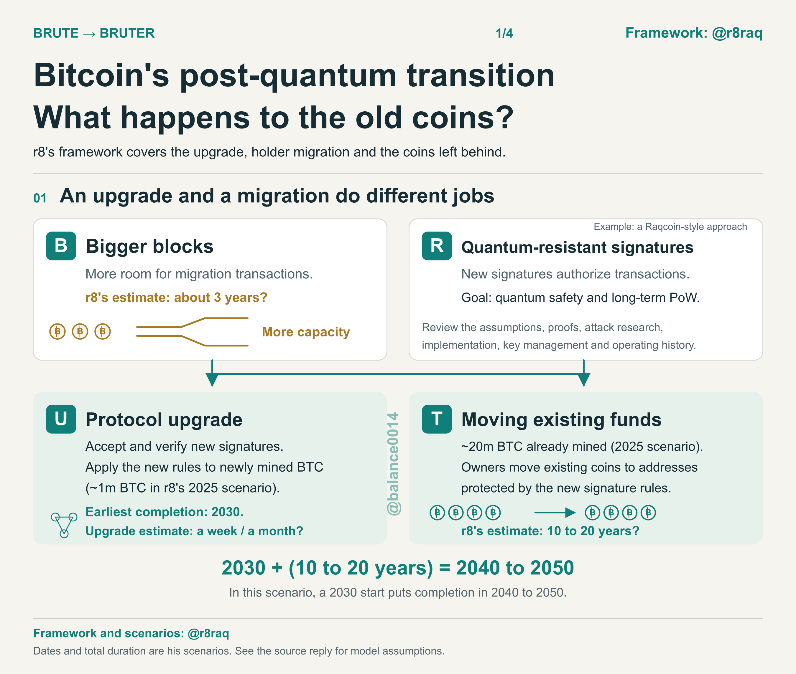
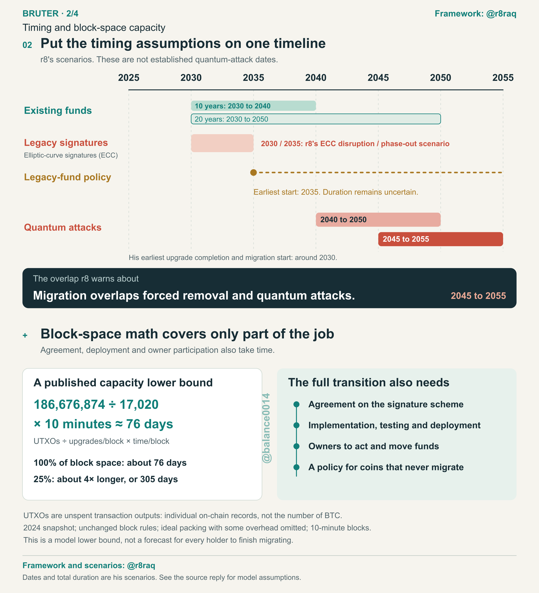
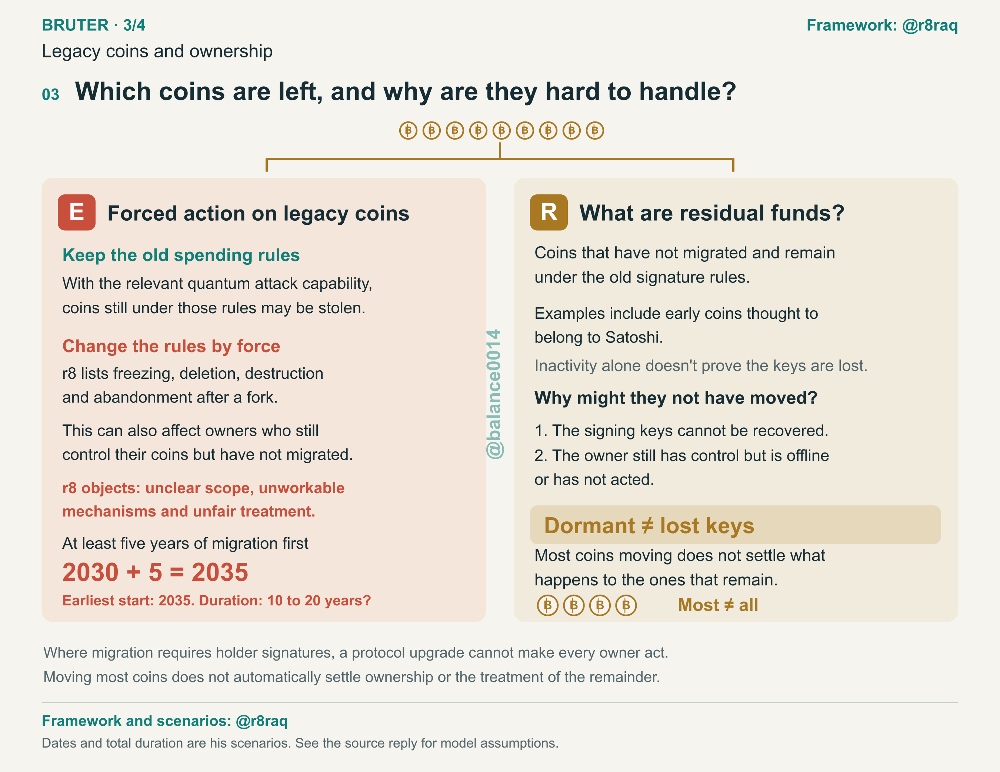
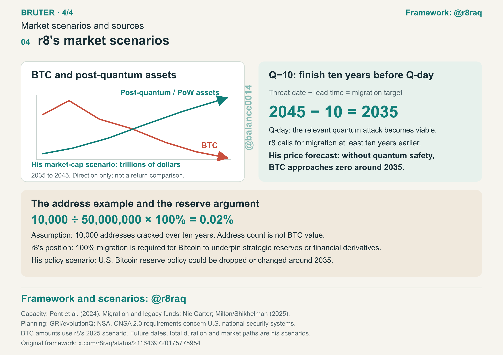

# Bitcoin migration and the coins left behind

If Bitcoin adds post-quantum spending rules, what happens to funds that stay under the old rules? r8's BRUTE/BRUTER framework puts that question alongside the software upgrade and the work holders would need to do.

[中文](README.zh-CN.md) · [Sources and their scope](sources.md) · [Research index](../../../README.md)

Framework: [r8 / @r8raq](https://x.com/r8raq). Explanation, diagrams and arithmetic checks: Balance Zhao ([@balance0014](https://x.com/balance0014)). Sources reviewed October 31, 2026; GitHub edition November 3, 2026.

## Where this fits

The [project map](../../../docs/projects.md) records where post-quantum features have been deployed. The [algorithm comparison](../../../docs/signature-sizes.md) describes specific signing parameters and encodings. This note follows the funds through a possible Bitcoin transition: which rules change, what holders must do, and what happens to funds that remain behind. It adds a migration and governance topic without changing the 17-project dataset or its October 23 snapshot.

## Reading BRUTER

r8's earlier BRUTE diagram has five parts; BRUTER adds a final R for residual funds. The letters organize his argument. They don't describe an adopted Bitcoin upgrade or a schedule approved by the network.

| Part | Meaning in r8's framework | How to read it here |
| --- | --- | --- |
| B | Bigger block size | His proposal to make more room for migration transactions. Whether a particular design needs a block-size change requires its own analysis. |
| R | Raqcoin quantum-safe digital signature | His named signing example. This note does not assess that implementation or establish it as Bitcoin's choice. |
| U | Upgrade | The network accepts and validates new spending rules. |
| T | Transfer | Under a holder-signed migration, holders move funds into outputs protected by the new rules. |
| E | Eliminate | The disputed treatment of funds that haven't migrated. r8 objects to forced disposal; listing this part doesn't mean he supports it. |
| R | Residual | Funds that remain under the old rules even after most holders have migrated. |

[Definitions and original diagrams: sources R1–R4.](sources.md#r8s-framework)



[Full-resolution PNG](charts/r8_Bitcoin_Mobile_EN_01.png) · [Editable SVG](charts/r8_Bitcoin_Mobile_EN_01.svg)

## Activating new rules and migrating existing funds

In the holder-signed approach discussed here, software can accept the new spending rules while existing outputs still depend on the old ones. A holder, wallet or custodian then needs to make the relevant migration transaction. Other proposed recovery or protocol designs may have different requirements.

r8 illustrates a start in 2030 and a migration lasting 10–20 years. Adding those inputs gives 2040–2050. The addition is reproducible; the assumed start and duration are his judgments. We haven't found a reproducible engineering model establishing his overall duration. His Q−10 target likewise expresses a preferred ten-year lead over an assumed threat date.

A separate 2024 paper by Pont, Kearney, Moyler and Perez-Delgado models chain capacity using 186,676,874 UTXOs, an optimistic 17,020 upgrades per block, and ten minutes per block. Using whole blocks gives:

```text
ceil(186,676,874 / 17,020) = 10,969 blocks
10,969 × 10 / 1,440 = 76.1736 days at 100% capacity
76.1736 / 0.25 = 304.6944 days at 25% capacity
```

These are historical, idealized processing figures. The model keeps block rules unchanged, packs transactions unrealistically tightly and omits some overhead. It doesn't measure agreement, implementation, deployment or holder response, and it doesn't establish r8's 10–20 years. Counting all UTXOs also differs from protecting a chosen share of BTC value. The paper and calculator prose have small rounding/count discrepancies; [the calculation note](sources.md#capacity-calculation) records them. Run `python3 scripts/bitcoin_capacity.py --check` from the repository root to reproduce our numbers.



[Full-resolution PNG](charts/r8_Bitcoin_Mobile_EN_02.png) · [Editable SVG](charts/r8_Bitcoin_Mobile_EN_02.svg)

## Who still controls the funds?

A long-dormant wallet may still have an owner who can sign. Other holders may have lost the credentials needed for an ordinary migration. Early mining history, present control and migration status describe different things, so they shouldn't be treated as mutually exclusive groups or inferred from inactivity alone.

Leaving old spending rules available may leave vulnerable funds open to theft if attackers acquire the required quantum capability. Making those funds unspendable could also lock out owners who still control them. r8 opposes forced freezing, deletion, destruction or abandonment through a fork. Milton and Shikhelman's May 2025 report separately discusses the property-rights dilemma and possible migration mechanisms; it doesn't endorse every part of his framework. See [sources R4 and P2](sources.md).



[Full-resolution PNG](charts/r8_Bitcoin_Mobile_EN_03.png) · [Editable SVG](charts/r8_Bitcoin_Mobile_EN_03.svg)

## What to check in a proposal

A proposal should identify the spending conditions it changes, the funds it protects and the action required from each holder or service. Activation records, wallet support and completed migration answer different questions. For funds left behind, the proposal also needs to explain any deadline, recovery route and change to spending rights.

Nic Carter's discussion of voluntary migration is useful background for the time holders need beyond a software upgrade. It isn't an endorsement of r8's dates, price forecasts or whole framework. [Source P3](sources.md#other-research).


## Earlier X editions

The [October 31 English post](https://x.com/balance0014/status/2116489959892775097) includes r8's market, price and timing scenarios. A [four-panel reply](https://x.com/balance0014/status/2116493781637980202) makes that original edition easier to read. The later [Chinese edition](https://x.com/balance0014/status/2116717628584779872) focuses on migration and holder rights. Those X editions differ in scope.

The diagrams on this page are unchanged copies of the original English edition. The Chinese page uses the later Chinese edition, which has a different scope. No forecast in the original English images is a finding established by this repository.

### Original English fourth panel: r8's scenarios

The fourth panel retains his market and price forecasts exactly as published. They are attributed scenarios.



[Full-resolution PNG](charts/r8_Bitcoin_Mobile_EN_04.png) · [Editable SVG](charts/r8_Bitcoin_Mobile_EN_04.svg)

## Attribution and reuse

Credit r8 for the BRUTE/BRUTER framework and his scenarios, and Balance Zhao for this explanation, visual arrangement and calculation code. Our original text and diagrams follow the repository's [CC BY 4.0 notice](../../../LICENSE); the scripts are MIT. Those grants cover our contribution only. Linked posts, papers and third-party ideas or artwork retain their own rights. No third-party source image is bundled here.
