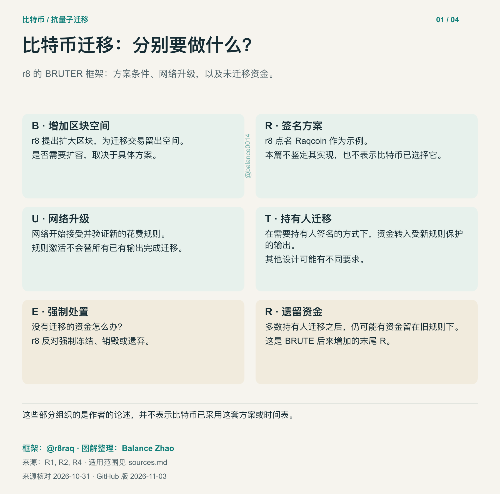
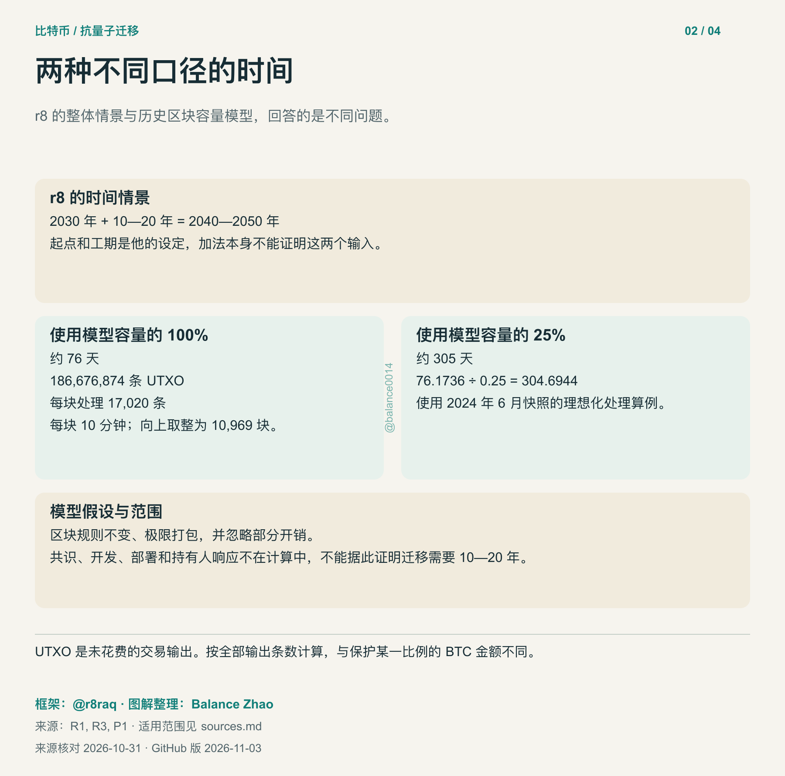
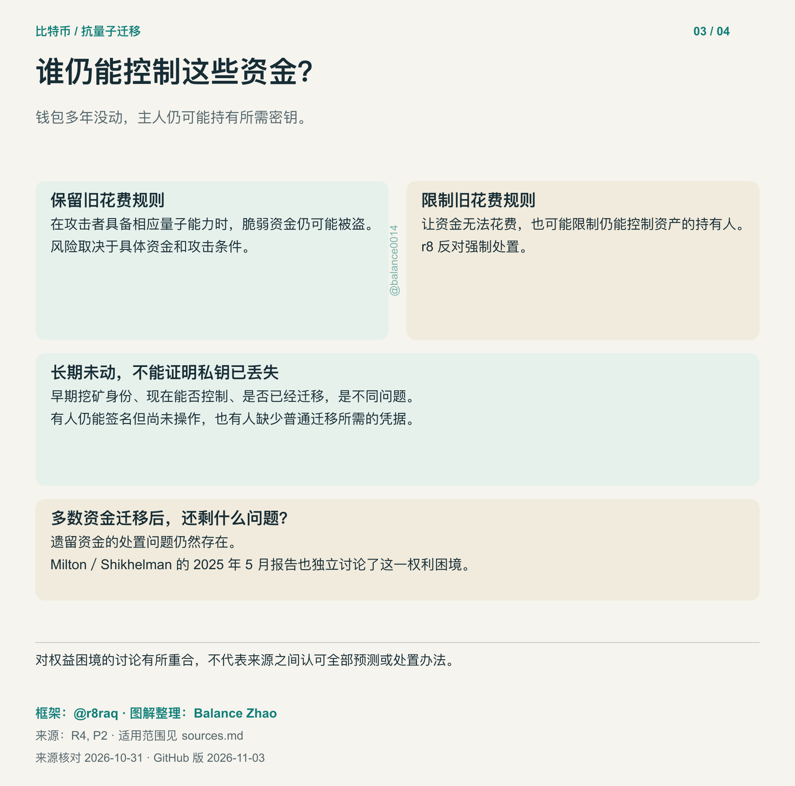
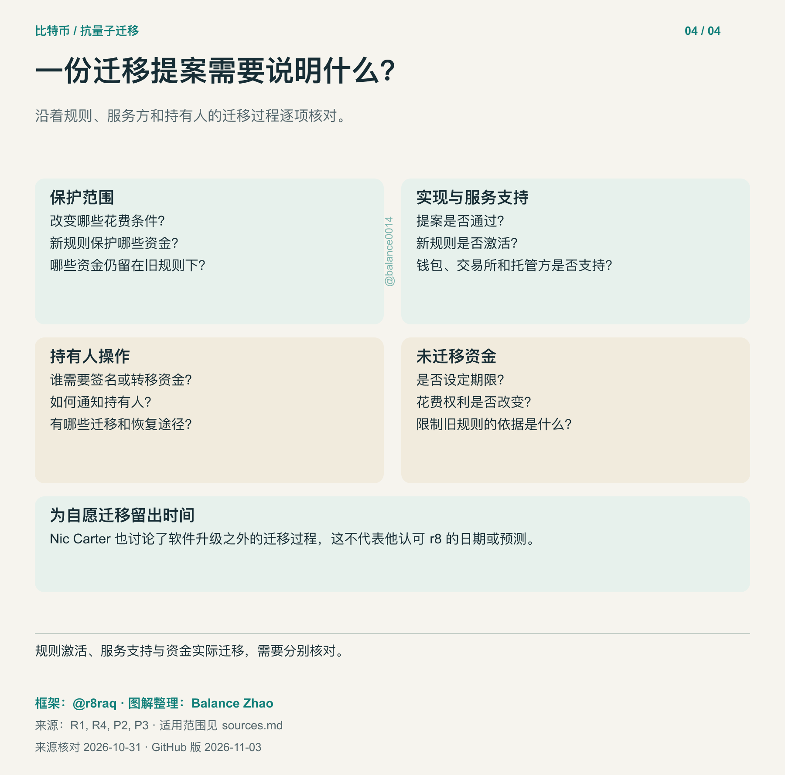

# 比特币迁移与未迁移资金

如果比特币增加抗量子花费规则，仍受旧规则控制的资金怎么办？r8 的 BRUTE／BRUTER 框架把这个问题，与网络升级、持有人实际迁移放在一起讨论。

[English](README.md) · [来源及适用范围](sources.md) · [研究总目录](../../../README.zh-CN.md)

框架来自 [r8／@r8raq](https://x.com/r8raq)；解释、图解与算术复核由 Balance Zhao（[@balance0014](https://x.com/balance0014)）整理。来源核对于 2026 年 10 月 31 日；GitHub 版整理于 11 月 3 日。

## 和前两张地图的关系

[项目地图](../../../docs/projects.md)记录哪些网络已经部署了哪些抗量子功能；[算法对比](../../../docs/signature-sizes.md)列出具体参数下的签名和公钥尺寸。这篇沿着比特币资金的迁移过程，解释规则改变、持有人操作，以及遗留资金的处置。专题独立收录，原有 17 个项目及其 10 月 23 日数据快照保持原口径。

## BRUTER 六个部分

r8 较早的 BRUTE 图有五个部分，后来的 BRUTER 增加了末尾的 R，表示遗留资金。这些字母组织的是他的论述，并不代表比特币已经采用了这套方案或时间表。

| 部分 | r8 框架中的含义 | 本篇的解释范围 |
| --- | --- | --- |
| B | 扩大区块 | 他提出增加迁移交易的容纳空间；具体方案是否需要扩容，要另行分析。 |
| R | Raqcoin 抗量子数字签名 | 他点名的签名方案示例。本篇不鉴定该实现，也不表示比特币已选择它。 |
| U | 网络升级 | 网络接受并验证新的花费规则。 |
| T | 资金迁移 | 在需要持有人签名的迁移方式下，把资金转入受新规则保护的输出。 |
| E | 强制处置 | 如何处理未迁移资金的争议。r8 反对强制处置，列出这一部分不等于支持清币。 |
| R | 遗留资金 | 多数持有人迁移后，仍受旧规则控制的资金。 |

[定义与原图：来源 R1—R4。](sources.md#r8s-framework)



[高清 PNG](charts/01-framework.zh-CN.png) · [可编辑 SVG](charts/01-framework.zh-CN.svg)

## 网络升级与资金迁移何时才算完成

在本篇讨论的持有人签名迁移方式下，软件开始接受新规则时，已有输出仍可能依赖旧规则。持有人、钱包或托管方还需要执行相应的迁移交易。其他恢复或协议设计，可能有不同的要求。

r8 举例设定 2030 年开始、迁移持续 10—20 年，两者相加得到 2040—2050 年。加法可以复算，起点和工期则属于他的判断。我们尚未找到能够证明其整体工期的可复算工程模型。他的 Q−10 目标，同样表达了相对假定威胁时点至少提前十年的主张。

另一个独立算例来自 Pont、Kearney、Moyler、Perez-Delgado 的 2024 年论文：使用 186,676,874 条 UTXO、每块最多处理 17,020 条、每块十分钟，按整块向上取整得到：

```text
ceil(186,676,874 ÷ 17,020) = 10,969 块
10,969 × 10 ÷ 1,440 = 76.1736 天，使用 100% 容量
76.1736 ÷ 0.25 = 304.6944 天，使用 25% 容量
```

这是历史快照下的理想化链上处理算例。模型保持区块规则不变，采用现实中无法完全达到的极限打包，并忽略部分开销；它没有计算共识、实现、部署和持有人响应，也不能证明 r8 所说的 10—20 年。按全部 UTXO 条数计算，与保护某一比例的 BTC 金额也不是同一口径。论文与计算器正文存在少量取整或块数差异，见[计算说明](sources.md#capacity-calculation)。在仓库根目录运行 `python3 scripts/bitcoin_capacity.py --check` 可以复算本篇数字。



[高清 PNG](charts/02-timing.zh-CN.png) · [可编辑 SVG](charts/02-timing.zh-CN.svg)

## 谁仍能控制这些资金

钱包多年没动，主人仍可能可以签名；也有持有人确实丢失了普通迁移所需的凭据。早期挖矿身份、现在能否控制、是否已经迁移，是不同的问题，不能当成互斥分组，也不能仅凭长期未动来判断。

保留旧花费规则，在攻击者具备相应量子能力时，可能让脆弱资金暴露于盗取风险；让这些资金无法花费，也可能影响仍能控制资产的持有人。r8 反对强制冻结、删除、销毁或通过分叉遗弃。Milton 与 Shikhelman 的 2025 年 5 月报告独立讨论了财产权困境和迁移机制，并不为 r8 整套框架背书。见[来源 R4、P2](sources.md)。



[高清 PNG](charts/03-ownership.zh-CN.png) · [可编辑 SVG](charts/03-ownership.zh-CN.svg)

## 看一份迁移提案，要查什么

提案需要说明改变哪些花费条件、保护哪些资金、持有人和服务方分别要做什么。规则激活、钱包支持、资金实际迁移，回答的是不同问题。对于遗留资金，还需要说明期限、恢复途径，以及花费权利是否会改变。

Nic Carter 关于自愿迁移的讨论，补充了软件升级之外持有人需要时间这一点；这不表示他认可 r8 的日期、价格预测或整套框架。见[来源 P3](sources.md#other-research)。



[高清 PNG](charts/04-proposal.zh-CN.png) · [可编辑 SVG](charts/04-proposal.zh-CN.svg)

## 之前在 X 上发布的版本

[10 月 31 日英文帖](https://x.com/balance0014/status/2116489959892775097)保留了 r8 的市场、价格和时间情景，后面的[四图回复](https://x.com/balance0014/status/2116493781637980202)方便分段阅读。后来的[中文帖](https://x.com/balance0014/status/2116717628584779872)集中讨论迁移与持有人权益。这些 X 版本的内容范围不同。

本页 GitHub 中英文图解的迁移与治理内容相互对应。早期预测通过上面的历史链接保留归属，本篇不提供价格目标或固定的量子破解日期。

## 署名与使用

引用 BRUTE／BRUTER 框架和作者情景时署名 r8；引用本篇解释、图解编排与计算代码时署名 Balance Zhao。我们原创的文字和图解遵循仓库的 [CC BY 4.0 说明](../../../LICENSE)，脚本使用 MIT。授权只涵盖我们有权授权的部分，链接中的原帖、论文及第三方思想或图像保留其权利。本目录没有打包第三方原图。
